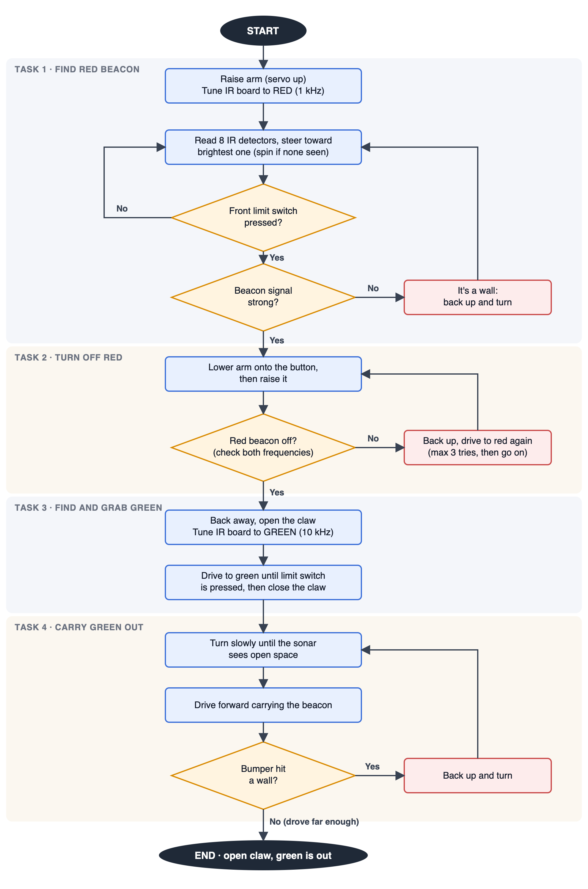

# ENGR 10 Robot Project

ROBOTC programs for the VEX Cortex robot in the ENGR 10 robot project: turn off the red IR beacon, then carry the green IR beacon out of the arena.

ROBOTC setup: Robot → Platform Type → VEX 2.0 Cortex, Natural Language PLTW; communication mode USB Only.

## Week 1 (`week1/`)

| File | Task |
|------|------|
| `practice1_ramp_up.c` | Practice 1: motor speed 0 → max in about 10 s |
| `practice2_swing.c` | Practice 2: speed swings between forward max and reverse max |
| `practice3_bumper.c` | Practice 3: bumper (digital port 1) stops the motor, release reverses it |
| `motor_servo_check.c` | 4.1.4: motor back and forth, servo to a set number of degrees |

All Week 1 programs use the motor on port 1; the servo check assumes the servo on port 2.

## Week 2+

- `gotobeacon.c`: GOTO_BEACON sample program from the course (Week 2: load and test)
- `robot_project.c`: **the program for the robot**: full run (Tasks 1–4), built on GOTO_BEACON
- `drive_calibration.c`: three short tests that measure the numbers the robot needs to find its way back to the start
- `servo_center.c`: holds the press-arm servo (port 3) at the center (0) so the arm can be attached at the right angle
- `servo_angle_test.c`: steps the press arm (port 3) through servo positions to find the up and press values

### Robot wiring (from the team's working setup)

| Port | Device |
|------|--------|
| in1, dgtl10–12 | IR receiver board |
| dgtl3 | Front limit switch |
| port1 / port10 | Right / left drive motors (negative speed = forward on this robot) |
| port2 | Claw servo (holds the green beacon) |
| port3 | Press arm servo (presses the red beacon's button, then presses down on the green beacon to hold it while pulling) |

No bumper and no ultrasonic sensor. Task 4 pulls the green beacon backward to 80 cm behind the estimated start position.

## Before the first full run

All settings are in the CALIBRATION section at the top of `robot_project.c`.

1. **Servo positions:** run `servo_angle_test.c` and set `PRESS_ARM_HOME_POS`, `PRESS_ARM_BUTTON_POS` and `PRESS_ARM_HOLD_GREEN_POS`. For the claw, change `port3` to `port2` in its first line and set `CLAW_OPEN_POS` and `CLAW_CLOSED_POS`.
2. **Drive numbers:** run `drive_calibration.c` and set `MAX_WHEEL_SPEED_CM_PER_SEC`, `TRACK_WIDTH_CM` and `PULL_SPEED_FACTOR` with the formulas at the top of that file. Without these the robot will not get the green beacon past the line.
3. **Front of the robot:** measure from the middle of the wheels to the front switch and set `ROBOT_FRONT_CM`.

## Running the robot

1. Charge the battery fully and push every cable in firmly.
2. Download `robot_project.c`. Put the robot behind the starting line, facing into the arena.
3. Press and release the front switch. The robot starts 1 second later.
4. With the robot connected, **Robot → Debugger Windows → Debug Stream** shows each step with its time, e.g. `12.4 s  touched beacon, PD_sum=4331`. Use the `PD_sum` at each touch to tune `TOUCH_SIGNAL_LEVEL`, and the times for the report.

Known limit: if the green beacon stands directly between the start and the red beacon, the IR board cannot tell the two apart well and the robot may not reach red.

## Program logic flow

Source: `docs/flowchart.svg`.
