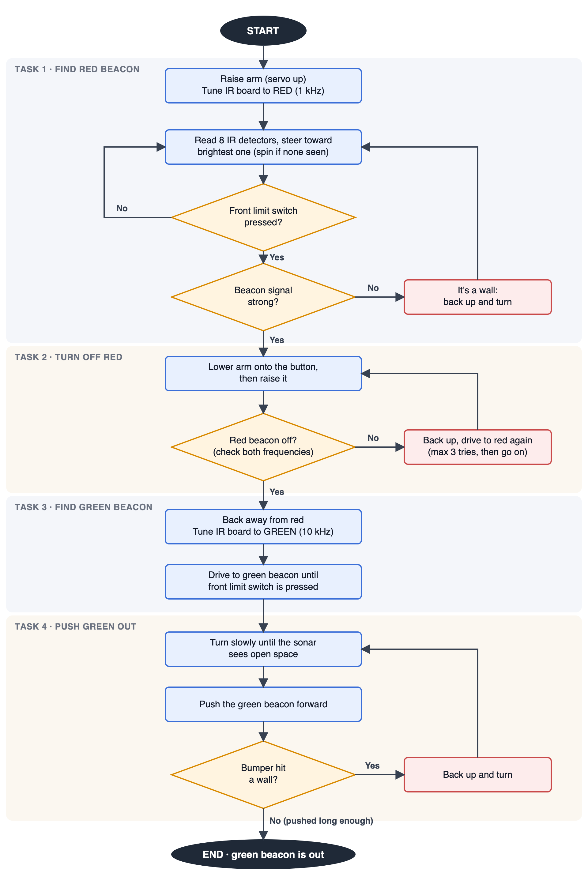

# ENGR 10 Robot Project

ROBOTC programs for the VEX Cortex robot in the ENGR 10 robot project: turn off the red IR beacon, then push the green IR beacon out of the arena.

ROBOTC setup: Robot → Platform Type → VEX 2.0 Cortex, Natural Language PLTW; communication mode USB Only.

## Week 1 (`week1/`)

| File | Task |
|------|------|
| `practice1_ramp_up.c` | Practice 1: motor speed 0 → max in about 10 s |
| `practice2_swing.c` | Practice 2: speed swings between forward max and reverse max |
| `practice3_bumper.c` | Practice 3: bumper (digital port 1) stops the motor, release reverses it |
| `motor_servo_check.c` | 4.1.4: motor back and forth, servo to a set number of degrees |

All Week 1 programs use the motor on port 1; the servo check assumes the servo on port 2.

## Week 2+

- `gotobeacon.c`: GOTO_BEACON sample program from the course (Week 2: load and test)
- `robot_project.c`: full run (Tasks 1–4), built on GOTO_BEACON

### Wiring assumed by robot_project.c

| Port | Device |
|------|--------|
| in1, dgtl10–12 | IR receiver board |
| dgtl1 | Front limit switch |
| dgtl2 | Bumper switch |
| dgtl3–4 | Ultrasonic sensor (INPUT in dgtl3, OUTPUT in dgtl4) |
| port1 / port10 | Right / left drive motors |
| port2 | Arm servo (the rod on top; via Motor Controller 29) |

Tune the arm servo positions and Task 4 values at the top of `robot_project.c` on the real robot.

## Program logic flow

Source: `docs/flowchart.svg`.
